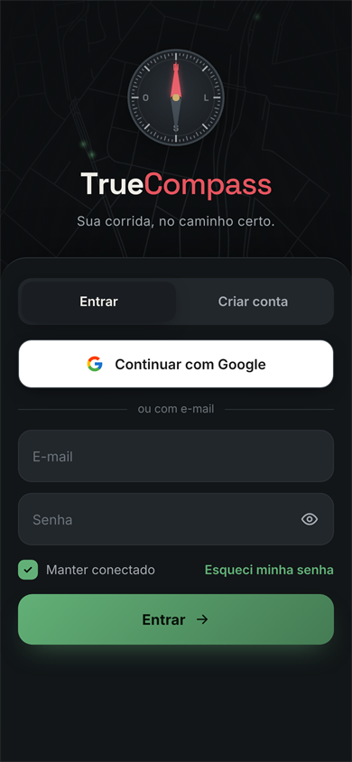
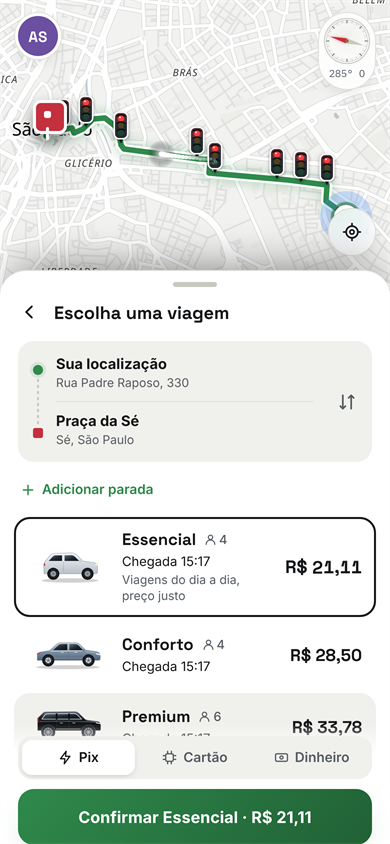
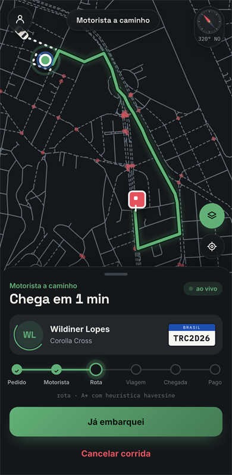
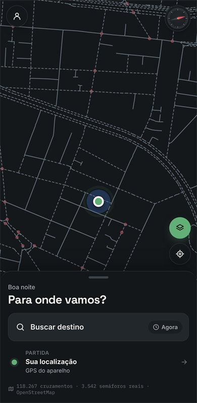
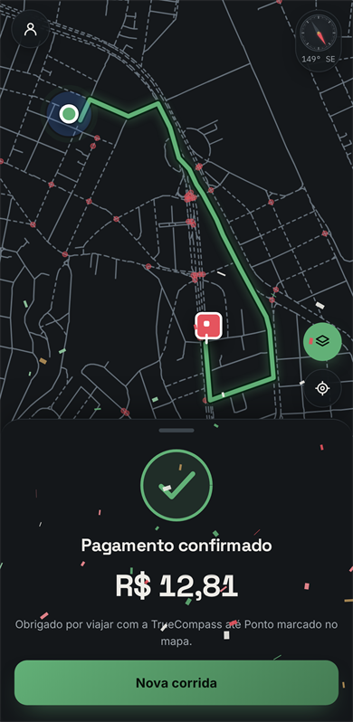
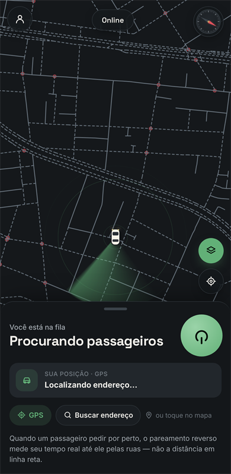
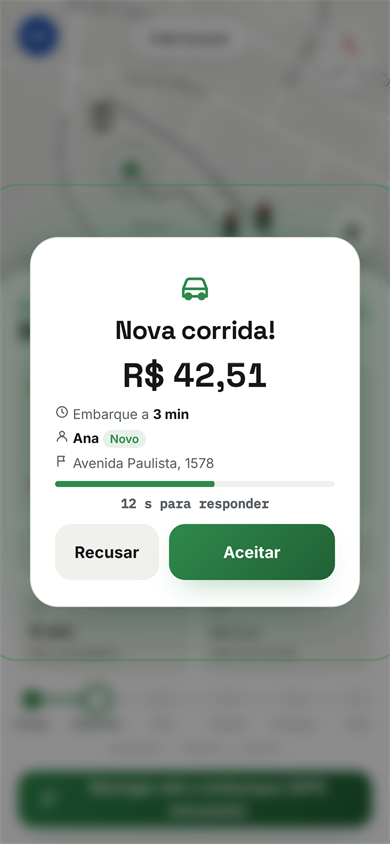
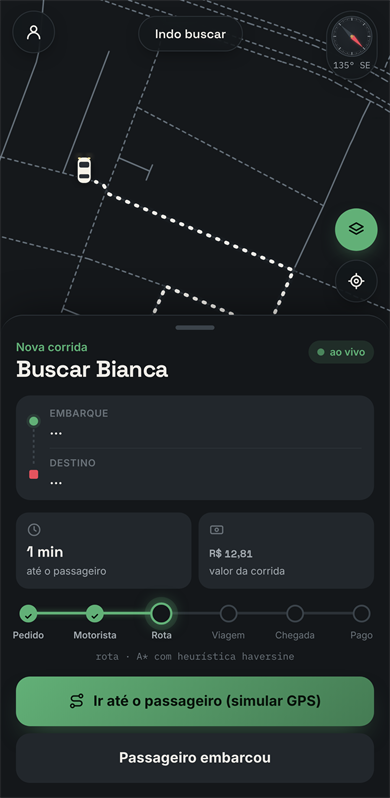
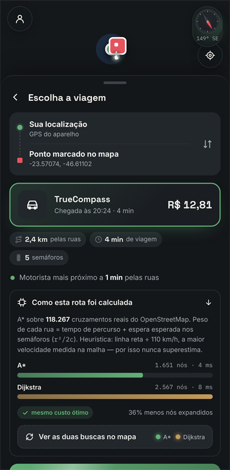

<div align="center">

# 🧭 TrueCompass

### Sua corrida, no caminho certo.

**Aplicativo de mobilidade urbana que encontra a rota mais rápida e o motorista que chega antes, sobre o mapa real de São Paulo.**

[**▶ Abrir o app**](https://prototipo-truecompass-frontend.vercel.app) · [Como rodar](COMO_RODAR.md) · [Índice do repositório](INDICE.md) · [Documentação técnica](docs/Documentacao_App/TrueCompass_Documentacao_Tecnica.pdf)

&nbsp;
&nbsp;


</div>

---

## O que é o TrueCompass

O TrueCompass é um aplicativo de corridas, no estilo dos apps de transporte que
já conhecemos: o passageiro diz para onde quer ir, vê o preço, confirma, e um
motorista vai buscá-lo. O motorista fica online, recebe a oferta, aceita e
segue a rota até o destino. Os dois acompanham a corrida ao vivo no mapa.

A diferença está em **como** o app decide. Cada escolha é feita por um
algoritmo com garantia matemática, rodando sobre os **137 mil cruzamentos
reais** da cidade de São Paulo, vindos do OpenStreetMap, com mão única,
avenidas e **6,8 mil semáforos**.

## O problema

Apps de corrida costumam escolher o motorista **mais perto em linha reta**. Só
que a cidade não é uma linha reta:

```
   A ── 300 m em linha reta ──► mas do outro lado da via expressa: chega em 7 min
   B ── 900 m em linha reta ──► pelas ruas, sem obstáculo:          chega em 3 min
```

Mão única, vias sem travessia e semáforos mudam o tempo de verdade. E não dá
para testar todos os caminhos entre 137 mil cruzamentos enquanto o passageiro
espera: a resposta tem de sair em milissegundos.

## Objetivo

> **Construir um app de mobilidade que encontra, com garantia matemática, a
> rota de menor tempo e o motorista que chega antes, e que funcione de ponta a
> ponta, na nuvem.**

Objetivos específicos:

- **Modelar a cidade como um grafo** ponderado pelo **tempo** de percurso, não pela distância.
- Pôr o **semáforo no peso da rua**: medido, 67% das rotas mudam de traçado quando os sinais entram na conta.
- Calcular rotas com **A\* + ALT**, sempre conferidas pelo **Dijkstra** (o resultado tem de ser o mesmo).
- Escolher o motorista por **busca reversa** (quem chega antes pelas ruas), com uma **quadtree** para achar os candidatos.
- Garantir que a corrida siga uma **ordem válida** (pedido → motorista → rota → viagem → chegada → pagamento), validada como grafo acíclico pelo algoritmo de Kahn.
- Entregar um **app completo no ar**: login, corrida, acompanhamento e pagamento.

---

## O app

### Para o passageiro

<table>
  <tr>
    <td align="center" width="25%"><br><b>Para onde vamos?</b><br><sub>Uma pergunta só, com a localização do GPS</sub></td>
    <td align="center" width="25%"><br><b>Escolha a viagem</b><br><sub>Rota, semáforos do caminho, categoria, preço e forma de pagamento</sub></td>
    <td align="center" width="25%"><br><b>Acompanhe ao vivo</b><br><sub>Motorista, carro, placa e cada etapa da corrida</sub></td>
    <td align="center" width="25%"><br><b>Pagamento</b><br><sub>Só depois que a corrida termina</sub></td>
  </tr>
</table>

### Para o motorista

<table>
  <tr>
    <td align="center" width="33%"><br><b>Online</b><br><sub>Um toque para entrar na fila; o GPS é enviado a cada 4 s</sub></td>
    <td align="center" width="33%"><br><b>Nova corrida</b><br><sub>Valor, distância do embarque e 20 s para aceitar</sub></td>
    <td align="center" width="33%"><br><b>Indo buscar</b><br><sub>Rota até o passageiro e o valor da corrida</sub></td>
  </tr>
</table>

### A matemática à vista

<table>
  <tr>
    <td width="34%" align="center"></td>
    <td>
      O próprio app mostra <b>como cada rota foi calculada</b>: quantos
      cruzamentos o A* examinou contra o Dijkstra, o tempo de cada um e a
      confirmação de que os dois chegaram ao <b>mesmo custo ótimo</b>.<br><br>
      O botão <i>Ver as duas buscas no mapa</i> anima a "onda" de cada
      algoritmo se espalhando pelas ruas: o Dijkstra cresce em todas as
      direções; o A* vai em direção ao destino.
    </td>
  </tr>
</table>

### O que o app faz

| | |
|---|---|
| 🔐 **Conta** | cadastro com código por e-mail, login com Google, "manter conectado", recuperar senha, bloqueio por tentativas |
| 🗺️ **Busca** | endereços reais de São Paulo, pontos marcados no mapa, locais salvos e recentes |
| 🛣️ **Viagem** | até 3 paradas, categorias Essencial, Conforto e Premium, preço calculado antes de confirmar |
| 🚦 **Rota** | semáforos do caminho desenhados no mapa e contados no tempo da viagem |
| 🚗 **Motorista** | oferta com prazo de aceite, passa ao próximo se recusar, ganhos do dia |
| 📡 **Ao vivo** | posição do motorista e etapas da corrida em tempo real (WebSocket) |
| 💬 **Durante a corrida** | chat entre passageiro e motorista, link público para alguém acompanhar |
| 💳 **Depois** | pagamento simulado (Pix, cartão ou dinheiro), avaliação de 1 a 5 e histórico |
| 🌗 **Visual** | tema claro e escuro de verdade, mapa vetorial e bússola com o rumo do destino |

---

## Como funciona por dentro

**Do mapa ao grafo**

```
OpenStreetMap        Poda                      Contração                 Peso = tempo
650 mil nós     ──►  só o que é alcançável ──► 137 mil cruzamentos  ──►  trecho da rua
da cidade de SP      nos dois sentidos         (79% a menos,             + espera média
                     (fortemente conexo)       mesmas rotas)             do semáforo r²/2c
```

**Uma corrida, passo a passo**

1. **Pedido:** o A\* + ALT calcula a rota e o preço.
2. **Quadtree:** encontra os motoristas da região, sem varrer a cidade.
3. **Busca reversa:** uma única busca, a partir do passageiro, mede quem chega antes **pelas ruas**.
4. **Oferta:** o melhor motorista tem 20 s para aceitar; se não aceitar, vai para o próximo.
5. **Ao vivo:** cada mudança de estado é validada pelo grafo da corrida e publicada aos dois.

### Resultados medidos

30 rotas sorteadas na cidade inteira, os mesmos pares para os três algoritmos:

| Algoritmo | Cruzamentos examinados | Tempo por rota | Rota encontrada |
|---|---:|---:|---|
| Dijkstra | 66.015 | 167 ms | ótima (referência) |
| A\* com linha reta | 45.877 | 169 ms | a mesma |
| **A\* + ALT** | **6.687** | **22 ms** | **a mesma** |

O ALT examina **~10× menos cruzamentos** e devolve exatamente a mesma rota:
nenhuma das 30 diferiu do Dijkstra. Ao todo, **286 testes automatizados**
cobrem os algoritmos, a API, o tempo real e o login.

---

## Tecnologias

| Camada | O que usa | Onde roda |
|---|---|---|
| App | React, TypeScript, Vite, MapLibre (mapa vetorial do OpenFreeMap) | Vercel |
| API | Python, FastAPI, WebSocket, JWT | Railway |
| Domínio | a corrida como grafo acíclico, validado por Kahn | Railway |
| Algoritmos | A\*, ALT, Dijkstra, quadtree, contração de grafo, Python puro | Railway |
| Banco | MySQL (SQLite em desenvolvimento) | Railway |

## Organização do repositório

```
frontend/     o app: app/ (atual, React + TypeScript) · web/ (versão anterior) · prototipo_html/
backend/      o servidor: api/ (HTTP) · dominio/ (regras) · infra/ (banco, rede, mapa) · tests/
matematica/   os algoritmos puros e o mapa em matriz · tests/
docs/         documentação técnica, banner, apresentação e material da disciplina
```

O mapa completo, arquivo por arquivo, está no [INDICE.md](INDICE.md).

## Como rodar

```bash
pip install -r requirements.txt
export JWT_SECRET="qualquer-coisa-em-desenvolvimento"       # Windows: $env:JWT_SECRET="..."
uvicorn --app-dir backend api.main:app --reload             # servidor em http://127.0.0.1:8000

cd frontend/app && npm install && npm run dev               # app em http://localhost:5180
```

Passo a passo completo, variáveis de ambiente e testes em [COMO_RODAR.md](COMO_RODAR.md).

## Documentação

| Documento | Conteúdo |
|---|---|
| [Documentação técnica](docs/Documentacao_App/TrueCompass_Documentacao_Tecnica.pdf) | definições, algoritmos e arquitetura |
| [Fundamentação matemática (Seção C)](docs/Documentacao_App/TrueCompass_Secao_C_Fundamentacao_Matematica.pdf) | definições, proposições e demonstrações |
| [Relatório executivo, 1ª parcial](docs/Documentacao_App/TrueCompass_1a_Parcial_Relatorio_Executivo.pdf) | entrega parcial do projeto |
| [Fluxograma](docs/Documentacao_App/Fluxograma.pdf) · [Apresentação](docs/Documentacao_App/Apresenta%C3%A7%C3%A3o%20TrueCompass.png) | visão geral do fluxo do app |
| [Banner da Mostra A3](docs/banner/v2/banner_truecompass_v2.pdf) · [Roteiro do pitch](docs/apresentacao/roteiro_pitch_e_demo.md) | apresentação na Expo São Judas |
| [Os algoritmos explicados](matematica/algoritmos/EXPLICACAO.md) · [As fórmulas explicadas](matematica/algoritmos/MATEMATICA.md) | guias didáticos, em linguagem simples |

---

## Equipe

Projeto acadêmico da unidade curricular **Matemática Computacional Aplicada**,
curso de **Análise e Desenvolvimento de Sistemas**, Universidade São Judas
Tadeu, Campus Santo Amaro, 2026/2.

**Integrantes:** Bianca Murcela Mascamudo · Carolina Chaves · Carolina Yukari Kague · Gabryela Araujo · Kauan Sousa · Wildiner Lopes

**Orientador:** Prof. Raulison Resende

<sub>Dados do mapa © colaboradores do OpenStreetMap · fundo do mapa: OpenFreeMap. Pagamentos simulados: nenhuma cobrança real acontece.</sub>
